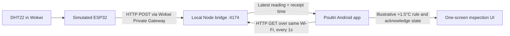

# Poultri Mobile + Wokwi Build Requirements

This document is the implementation guide for an AI coding assistant or engineer. Follow [mvp-requirements.md](mvp-requirements.md) for product scope and demo behavior. Build only the local prototype described here; do not recreate the deleted desktop simulator or add production features.

## Current baseline

- Mobile app: Expo Router, React Native, TypeScript, Expo SDK 57, branded single-screen placeholder in `mobile/`.
- Android EAS preview profile already produces an internal APK.
- No Wokwi project, local bridge, sensor state, or app connectivity exists yet.
- Keep the supplied logo and wordmark unchanged. Treat all readings as simulated.

## Architecture

Use Wokwi for VS Code with a PlatformIO ESP32 Arduino project. Its VS Code extension includes a private IoT Gateway, and Wokwi firmware can reach local services through `host.wokwi.internal`. The public cloud gateway cannot reach the laptop's local network. [Wokwi VS Code setup](https://docs.wokwi.com/vscode/project-config), [Wokwi ESP32 networking](https://docs.wokwi.com/guides/esp32-wifi), [PlatformIO project setup](https://docs.wokwi.com/vscode/platformio).

Keep three small parts in the repository:

- `wokwi/`: `platformio.ini`, `src/main.cpp`, `diagram.json`, and `wokwi.toml` for one ESP32 + DHT22 simulation.
- `bridge/`: one Node.js server using the standard library only; no desktop UI, database, or external service.
- `mobile/`: one Expo route for connection setup, live readings, alert state, and reset.

## Data and interfaces

### Firmware to bridge

- Connect the simulated ESP32 to Wokwi's virtual Wi-Fi and POST a reading once per second to `http://host.wokwi.internal:4174/api/reading`.
- Request JSON shape: `{ "temperatureC": 28.8, "humidityPct": 64 }`.
- On startup or HTTP failure, keep retrying and report connection/error details to the Wokwi serial monitor. Do not block sensor updates indefinitely while retrying.

### Bridge API

- Listen on port `4174`, bound to `0.0.0.0` so the Android phone can reach the laptop over the same private Wi-Fi.
- `GET /api/health` returns `{ "ok": true }`.
- `POST /api/reading` validates finite temperature and humidity values, stores only the latest valid reading in memory, adds an ISO-8601 `receivedAt` timestamp, and returns `{ "ok": true }`. Reject malformed or out-of-range values with a 4xx response.
- `GET /api/reading` returns `{ "reading": null }` before the first valid sample, otherwise `{ "reading": { "temperatureC": 28.8, "humidityPct": 64, "receivedAt": "..." } }`.
- Use no authentication for this synthetic, local-only demo. Do not expose or tunnel the bridge to the public internet; document that it is for a trusted private LAN only.

### Mobile app

- Keep a single screen. Include a bridge URL input, Connect action, connection state, temperature/humidity cards, sample age, inspection prompt, Acknowledge, and Reset Demo.
- Use `http://<laptop-LAN-IP>:4174` in the phone app. The Wokwi firmware uses `host.wokwi.internal`; those addresses serve different clients.
- On Connect, check `/api/health`, then poll `/api/reading` once per second. Stop polling when disconnected or the screen unmounts.
- Show **Waiting for Wokwi data** before the first sample. Mark the connection disconnected on request failure and mark readings stale when `receivedAt` is more than five seconds old. Retain the last values only with an explicit stale label; do not process stale samples for new alerts.
- Keep the initial sample as the baseline for the current app session. Create one alert when `temperatureC - baseline.temperatureC >= 1.5`. Humidity is not part of the rule. When the delta falls below 1.5°C after an alert, show the condition as recovered without deleting the alert.
- Acknowledge changes only the local alert record. Reset clears the baseline and alert; the next fresh sample becomes the reference. Do not persist readings, alerts, or bridge URL between launches for this demo.

### Android local networking

The phone must be on the same Wi-Fi as the laptop. Configure Android local HTTP access for the installable build through the Expo config plugin supported by the current SDK. `expo-build-properties` supports `usesCleartextTraffic`; add the SDK-compatible package/config only for this need, without restoring the former ARM64 restriction or notification/Firebase configuration. Verify behavior in Expo Go and a fresh EAS APK. [Expo SDK 57 app config](https://docs.expo.dev/versions/v57.0.0/config/app/), [Expo Build Properties](https://docs.expo.dev/versions/latest/sdk/build-properties/).

Keep the firewall rule limited to the private network. Do not add camera permissions, background services, push permissions, cloud credentials, or an internet-facing endpoint.

## Implementation order for an AI coding assistant

1. **Inspect:** Read repository and `mobile/AGENTS.md` instructions, current Expo SDK/config, and both requirements docs. Confirm the checkout and preserve unrelated user changes.
2. **Build Wokwi first:** Add the ESP32/DHT22 diagram and PlatformIO firmware. Compile it, start the Wokwi simulation, and confirm sensor changes appear in serial output. Add the local HTTP POST only after the sensor reads correctly.
3. **Build the bridge:** Add the small Node server and API above. Verify health, no-reading, valid-reading, malformed JSON, invalid values, and latest-reading behavior with local HTTP requests.
4. **Connect the app:** Replace the placeholder with the single-screen experience. Implement URL entry, health check, polling, freshness/error states, the relative demo alert, acknowledgement, recovery, and reset. Keep network transport and alert state logic simple and locally scoped.
5. **Configure Android networking:** Add only the Expo-compatible local HTTP setting required for the APK. Resolve the laptop LAN address from the bridge startup output or presenter instructions; do not invent a fixed LAN IP in source.
6. **Prove the end-to-end flow:** Run Wokwi, bridge, and the Android app on the same Wi-Fi. Change DHT22 temperature and verify update, threshold, acknowledge, recovery, disconnect/stale, and reset behavior.
7. **Finish the docs:** Update the README, implementation brief, agent guidance, and mobile setup instructions so this guide is authoritative and the deleted desktop simulator is not referenced as a required component.

For each step, report what changed and the command/result used to verify it. Stop and report blockers when a required Wokwi Gateway, PlatformIO, Android device, or network capability is unavailable; do not replace the selected architecture with a cloud broker without new direction.

## Verification and acceptance

- Firmware: `pio run`; validate `diagram.json` with `wokwi-cli lint` when the CLI is installed; start the configured simulation from Wokwi for VS Code.
- Bridge: verify health, empty state, valid POST/GET round trip, invalid payload rejection, and LAN reachability from the phone.
- Mobile: run `npm run lint`, `npx tsc --noEmit`, Expo config resolution, and an Android JS bundle export.
- Device acceptance: on Android over the same Wi-Fi, connect to the printed laptop URL; see a fresh reading update after a Wokwi change, prompt on the 1.5°C rise, acknowledgement, recovered state, and successful reset. Confirm stale/disconnected states after stopping Wokwi or the bridge.
- Demo acceptance: with setup complete, time the presenter script in `mvp-requirements.md`; it must finish in under two minutes.

Passing lint, type, or bundle checks is not proof of bridge or phone delivery. Do not describe the Wokwi simulation as physical sensor integration, on-site poultry processing, an offline field result, or a validated farm alert rule.
